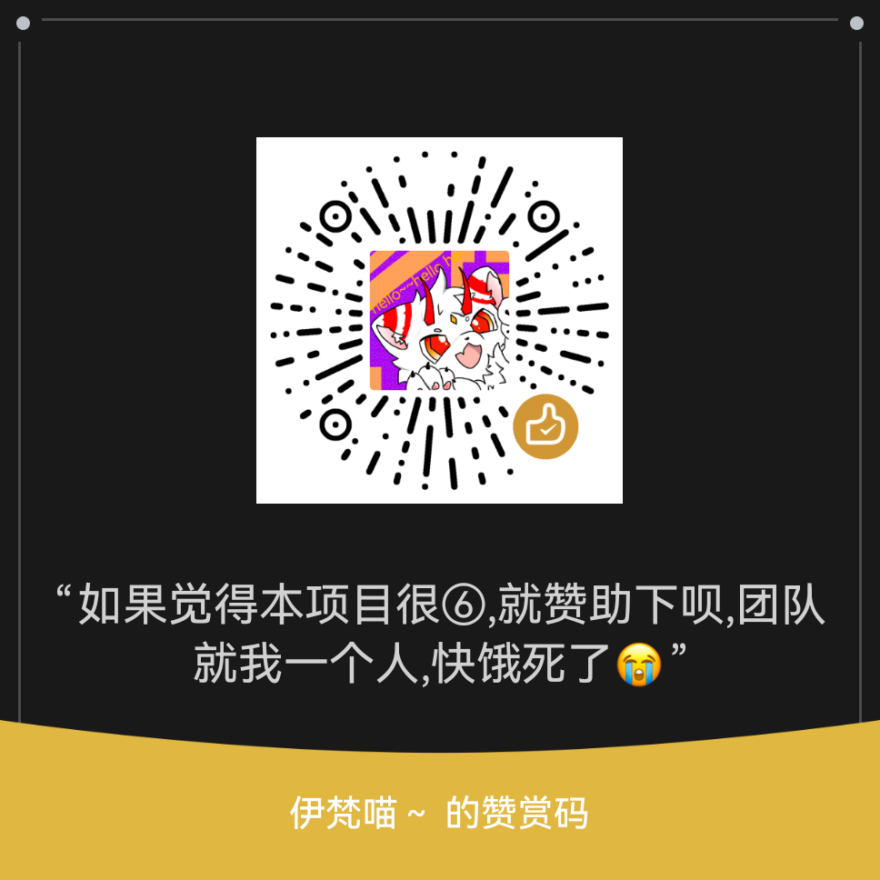

# cc-haha Android

> 把 Claude Code 工作台装进安卓手机：**本地跑 AI 编程助手 + 本地编译工具链，全程无需连接电脑。**

在手机上完成「提问 → 写代码 → 编译 → 运行验证」的完整闭环。内置 Node 运行时与
多语言工具链，支持在本机交叉编译 Linux / Windows / Android 三端产物。

---

## 特性

### AI 编程工作台（完整移植上游 cc-haha）

- **多会话工作台**：标签页、项目切换、会话历史、全局搜索
- **完整 Agent 能力**：工具执行（Bash/Edit/Grep…）、Diff 审阅、MCP 管理、SubAgent、Workflow 编排、技能市场
- **模型自选**：Claude / ChatGPT / Grok 官方账号，或 DeepSeek、Kimi、智谱 GLM 等第三方 API，以及 LM Studio / Ollama 本地端点
- **移动端界面**：复用上游 H5（767px 断点、触摸适配、安全区、软键盘处理），WebView 原生容器承载

### 本机编译工具链（预置 88 个包）

Python 3.14 · Clang 21 / LLVM · Git · Make · CMake · Ninja · ripgrep · Bash · OpenSSH · curl · coreutils …

### 三端交叉编译（按需下载）

| 目标平台 | 工具链 | 产出 |
|---|---|---|
| Linux | clang（原生） | 本机可执行文件 |
| **Windows** | `llvm-mingw-w64` | `.exe` / `.dll`（PE 文件） |
| **Android** | openjdk-17 + aapt2 + d8 + apksigner | 手机上直接构建 APK |

### 特权能力（可选，需 Shizuku 兼容环境）

- 自动申请 **Shizuku / Dhizuku** 权限，获得 shell 级能力（访问受限目录、执行特权命令）
- 内置**特权命令通道**（`127.0.0.1` + 一次性 token），Agent 可在需要时以 shell 身份执行命令

### 工作目录在公共存储

默认工作区 `/storage/emulated/0/cc-haha`，**文件管理器可直接访问**你的代码。
（运行时与工具链在应用私有目录——那里才能执行二进制。）

---

## 安装

1. 下载 `app-release.apk` 安装
2. 首次启动自动解压运行时与工具链（约 1-3 分钟，通知栏可见进度）
3. **准备内核**：App 会进入引导页，选择来源后在设备上完成获取与构建（约 1-3 分钟）。
   构建成功后自动备份；此后每次启动都会校验完整性，损坏时自动用备份恢复。
4. 在设置里配置模型供应商与 API Key，开始会话

### 内核来源（引导页三选一）

| 来源 | 说明 | 能力 |
|---|---|---|
| **cc-haha 镜像（GitCode）** | 从 GitCode 的 cc-haha 镜像拉取源码，在设备端用内置 esbuild 构建 | 完整：H5 工作台 + CLI + IM 适配器 |
| **Claude Code 官方包** | 从 npmmirror 下载 Anthropic 官方 npm 包，免构建直接使用 | 仅命令行通道（官方包不含 H5 工作台后端） |
| **本地压缩包** | 导入你自备的 cc-haha 源码包（`.tar.gz` / `.zip`） | 完整 |

> APK 不内置内核产物，仓库也不含上游内核源码（`runtime/upstream/src/`）——
> 内核由使用者自行获取，详见 [来源与致谢](#来源与致谢)。
> 设备端构建所需的全部材料（依赖、esbuild、构建脚本）已随 APK 预置，**离线也能构建**。

### 华为 / 荣耀设备必做

系统设置 → 应用 → cc-haha → **应用启动管理 → 关闭「自动管理」**
（EMUI 会激进清理后台，不设置的话锁屏后任务可能中断）

### 可选：Shizuku 兼容环境

安装 [Shizuku](https://shizuku.rikka.app/) 或兼容实现（如 Dhizuku 系）并启动其服务，
App 会在启动时自动申请权限。授权后 Agent 可访问 `/data/local/tmp` 等受限位置。

---

## 架构

```
┌─────────────────────────────────────────────────────┐
│  Android App (Kotlin, targetSdk 28)                 │
│                                                     │
│   WebView ──── http://127.0.0.1:3456 ────┐          │
│                                          ▼          │
│   ServerService（前台服务 + 看门狗）  Node 版 cc-haha │
│        │                              server        │
│        │                                  │         │
│        ├─ RuntimeInstaller                │ spawn   │
│        │  （解压 runtime.pkg）             ▼         │
│        │                              CLI 子进程     │
│        ├─ ToolchainManager            （Agent 本体） │
│        │  （按需下载工具链）                │         │
│        │                                  ▼         │
│        ├─ PrivilegedExecServer        模型 API      │
│        │  （特权命令通道）                           │
│        └─ ShizukuHelper（权限）                      │
└─────────────────────────────────────────────────────┘
```

**关键设计**：

- **内核由使用者获取、设备端构建**：APK 与仓库都不含上游内核代码/产物。
  引导页拉取源码后，用预置的 `buildkit.pkg`（公开 npm 依赖 + esbuild + compat 适配层）
  在设备上完成构建。
- **上游零修改（适配层）**：`runtime/compat/` 是 Bun API → Node 的兼容层
  （`Bun.serve` → `node:http`+`ws`、`bun:sqlite` → `node:sqlite`、`feature()` 宏、平台分支等），
  对上游源码零侵入 —— 因此上游换任何版本/来源都能直接适配。
- **内核自愈**：构建产物落 `runtime/dist/` 并生成 manifest（路径/大小/SHA256），
  同时快照到 `kernel-backup/`。每次启动做快速校验，异常时自动从备份恢复，
  避免"改坏了要重装"。
- **targetSdk 28**：Android 10+ 禁止 `targetSdk ≥ 29` 的应用在私有目录执行二进制（W^X），
  而本应用需要在私有目录运行 Node 与工具链。不走应用商店，无上架约束。
- **code splitting + V8 compile cache**：手机端冷启动从 5 分钟优化到 6 秒。

---

## 构建

见 **[BUILD.md](BUILD.md)**（含环境要求、分步说明、常见问题）。

```bash
export JAVA_HOME=/path/to/jdk-17
export ANDROID_HOME=/path/to/android-sdk
bash build-apk.sh
```

---

## 已知边界（如实说明）

| 项 | 说明 |
|---|---|
| **Windows 程序运行** | 只能用 `llvm-mingw-w64` **编译**出 `.exe`；**运行**需 proot 包裹（Android 的 W^X 策略禁止 App 私有目录的文件映射为可执行内存）。编译产物可在 Windows 上运行。 |
| 外部存储限制 | `/storage/emulated/0` 是 fuse 挂载：**不可执行、无符号链接**。编译产物建议输出到 `/data/local/tmp`。 |
| 桌面专属功能 | Computer Use 控制桌面、Electron 终端、桌面宠物、内置浏览器预览——在安卓上自然降级。 |
| 性能 | 手机 CPU 单核性能约为 PC 的 1/10，首次启动 CLI 与大型编译会明显较慢（已针对性优化）。 |
| 签名 | 仓库默认用 debug 签名（便于自行安装调试）。正式分发请配置自己的 keystore。 |

---

## 项目结构

```
├── android/            Android 壳工程（Kotlin）
│   └── app/src/main/
│       ├── java/com/cchaha/android/    壳 / 服务 / 内核管理 / 工具链 / Shizuku
│       └── assets/                     runtime.pkg + toolchain-core.pkg + buildkit.pkg（脚本生成）
├── runtime/            Node 运行时与适配层
│   ├── compat/         Bun → Node 兼容层（本项目原创）
│   ├── build/          esbuild 打包配置 + Android 平台前导脚本（原创）
│   ├── upstream/       上游工作台源码（src/ 不在仓库内，见 .gitignore 说明）
│   └── dist/           内核产物（设备端构建产生，不入库）
├── tools/              构建与获取脚本（含内核构建套件组装）
└── docs/open-source/   开源治理文档
```

---

## 许可

**Apache-2.0** — 见 [LICENSE](LICENSE)。

本 App 分发了 Termux 生态的二进制，其中包含 GPL 组件（`bash`、`coreutils`、`make`、
`git` 等）。它们与本项目是**聚合**关系（GPL-3.0 §5：独立程序置于同一分发介质上
不使许可证传染），通过进程调用使用、不构成衍生作品，因此不影响本项目采用
Apache-2.0。各组件的来源、源码获取方式与完整清单见
**[THIRD_PARTY_NOTICES.md](THIRD_PARTY_NOTICES.md)**。

---

## 来源与致谢

- 上游工作台：[NanmiCoder/cc-haha](https://github.com/NanmiCoder/cc-haha)（MIT）
- 运行时代码：源自社区流传的 Claude Code 公开版本
- Android 移植层（`android/` + `runtime/compat/` + `tools/`）：本项目原创
- 二进制来源：[Termux](https://termux.dev/)（`packages.termux.dev`）
- 交叉编译工具链：[llvm-mingw](https://github.com/mstorsjo/llvm-mingw)
- 权限桥接：[Shizuku](https://github.com/RikkaApps/Shizuku) / [Dhizuku](https://github.com/iamr0s/Dhizuku)

### 关于内核代码

本仓库**不包含**上游内核源码（`runtime/upstream/src/`），APK 也不内置其构建产物。
内核由使用者在首次启动时自行获取（GitCode 镜像 / 官方 npm 包 / 自备压缩包），
并在设备本地完成构建。仓库与 APK 只包含原创的移植层、构建脚本与工具链集成，
不构成对上述运行时代码的再分发；使用者获取与使用该代码应自行了解并遵守其适用条款。

感谢以上项目与社区的工作。

---

## 支持这个项目

如果这个项目帮到了你，欢迎请我喝杯奶茶：

<p align="center">
  
</p>

赞助完全自愿，并且：

- **不构成购买服务** —— 这是赠与，不是交易
- **不影响项目许可与功能** —— 本项目以 Apache-2.0 发布，所有人平等获得相同权利
- **不承诺功能优先级或时间表**

也欢迎用别的方式支持：提 Issue、分享使用体验、把它介绍给需要的人。
